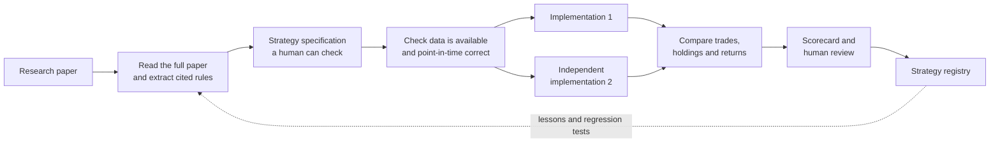

# Marginalia

**Give Marginalia a quantitative finance research paper. Get back an honest,
evidence-backed report on whether the strategy in it was implemented faithfully,
whether its results reproduce, and what is still unknown.**

> Status: early development. The first product (V1) is a research verification
> tool. It does not place trades and does not promise profitable strategies.

---

## The problem

Thousands of trading-strategy papers are published every year. Most of them are
hard to trust in practice:

- Replicating one paper by hand takes a skilled quant days or weeks.
- Papers leave out details such as exact timing, universe, costs, and data
  adjustments. Small differences change the results completely.
- AI tools can now turn a paper into backtest code in minutes, but the output
  usually *looks* convincing without anyone checking whether it follows the
  paper, uses only data that was available at the time, or would survive
  realistic costs.

A good-looking backtest is easy to produce. A *trustworthy* one is not.

## What we are building

Marginalia is an AI research analyst that reads a paper and then **checks its own
work**. For every paper it produces:

1. **A cited strategy specification.** Every rule (signal, universe, rebalance,
   parameters) links back to the page, quote, or equation it came from.
   Assumptions and missing details are labeled, never silently filled in.
2. **Two independent implementations** of the strategy, run on the same data,
   then compared trade by trade. Agreement is evidence; disagreement is a finding.
3. **A scorecard** with a separate pass / fail / unknown result for each question
   below. Unknown never counts as a pass, and one critical failure cannot be
   averaged away by good returns.
4. **A registry entry**, whether the paper was verified, rejected, blocked by
   missing data, or failed. Failures are kept and explained, because they are
   useful too.

| Question the report answers | In plain terms |
| --- | --- |
| Source fidelity | Did we implement what the paper actually says? |
| Data integrity | Right stocks, right history, corporate actions handled? |
| No look-ahead | Did every decision use only information available at that moment? |
| Replication | Do we get results comparable to the paper's own tables? |
| Engine agreement | Do two independent implementations agree? |
| Robustness | Does it survive nearby parameters, other periods, and real costs? |
| Economic sense | Is it just market exposure in disguise? Is turnover realistic? |

## How it works



AI agents do the reading, interpretation, and first-draft implementation.
Deterministic code does the accounting and the checks. A human reviews the
result before anything is accepted.

## Who it is for

Small funds, RIAs, family offices, independent quants, and research teams that
want to evaluate academic strategies quickly without trusting an unchecked
backtest.

## Roadmap

| Stage | What it adds |
| --- | --- |
| **V1: verification** (now) | Paper in, cited spec, two implementations, scorecard, registry. Goal: a frozen 20-paper benchmark where every case is verified, rejected, or explicitly blocked. |
| V2: research expansion | Automatic discovery of new papers, plus combining and testing variants with full lineage. |
| V3: paper fund | Approved strategies run as a portfolio with risk limits, through Alpaca **paper** trading. |
| V4: feedback | Compare live paper behavior to the backtest and feed lessons back into research. |
| Later decision | Real capital only after roughly a year of real paper-trading track record. |

## Who does what

| Vlad: understand the research | Shazil: test and judge the evidence |
| --- | --- |
| Read papers fully, including tables, equations, appendices | Backtest engine, data, accounting, and timing correctness |
| Produce cited specs; flag assumptions and unknowns | Independent second implementation and trade-level comparison |
| Check implementations against the source | Robustness, bias checks, scorecard, and registry |
| Measure extraction accuracy on a fixed paper set | Later: portfolio, risk, and Alpaca paper trading |

Details: [system plan](docs/AI_NATIVE_HEDGE_FUND.md) and
[work plan for Shazil and Vlad](docs/WORKSTREAMS.md).

## Where we are today

| Built (prototype) | Partly built | Not built yet |
| --- | --- | --- |
| Deterministic backtester with six strategy templates | Paper reading (text and OCR; long papers truncated) | Independent second engine and comparison |
| Validated strategy spec (Pydantic) | Template router that decides which strategy family a paper matches | Full point-in-time data (historical index membership, delistings) |
| Cached market data, metrics, basic position sizing | LLM extraction of specs from papers (Nebius models) | Scorecard, registry, and audit trail |
| LangGraph pipeline, FastAPI endpoints, CLI | Experimental critic and verifier agents (`experiments/quantbros/`) | 20-paper evaluation benchmark |
| Offline test suite and CI | | Alpaca paper trading |

Current backtests are **preliminary research**. By default the engine picks the
best parameters on the same period it reports, so use `--no-optimize` for a
baseline and do not read the numbers as validated performance.

## Run it

Python 3.12 recommended.

```bash
python3.12 -m venv .venv
source .venv/bin/activate
python -m pip install -r requirements-core.lock
python -m pytest tests
```

Backtest an example strategy (downloads market data, no AI or API key needed):

```bash
python -m marginalia.cli backtest --spec examples/sector_rotation.json --no-optimize
```

Run the API, then open `http://127.0.0.1:8000/docs`:

```bash
python -m uvicorn marginalia.api.app:app --reload
```

Analyze a paper end to end (needs `NEBIUS_API_KEY` in a local `.env` with funded
access; set `NEBIUS_FAST_MODEL` / `NEBIUS_POWER_MODEL` to models your account can
use):

```bash
python -m marginalia.cli paper --pdf agents/strategy_extraction/quantmentals.pdf --no-optimize
```

OCR fallback also needs Tesseract installed. Optional sentiment agents use
`requirements.txt`, `OPENROUTER_API_KEY`, and `TAVILY_API_KEY`. Keep all keys in
the git-ignored `.env`. Nothing here places brokerage orders.

## Repository map

| Path | What is in it |
| --- | --- |
| `marginalia/` | Current engine, data, extraction agents, router, graph, API, sizing |
| `tests/`, `examples/` | Offline tests and an example strategy spec |
| `agents/strategy_extraction/` | Original paper-to-code prototype and source PDFs |
| `experiments/quantbros/` | Research snapshot: critic, verifier, generated-code trials |
| `agents/sentiment/` | Optional news/social collection and FinBERT scoring |
| `frontend/`, `web/` | Early UI prototypes (not the product) |
| `docs/` | Plans, ownership, and supporting notes |
| `spec.md` | Historical first build proposal; the docs above take precedence |

See the [cleanup record](docs/CLEANUP.md) for what was moved or removed.

## Team workflow

- `main` is the reviewed baseline. Only Shazil (`@Shazil10`) merges into it, via
  pull requests that pass the `core-tests` CI check.
- Shazil works on `Shazil`, Vlad works on `Vlad`. Both open pull requests into
  `main`.

To bring your branch up to date with `main` (commit or stash your own work first):

```bash
git fetch origin
git switch Vlad        # or: git switch Shazil
git merge origin/main
```

More detail: [branches and merge workflow](docs/WORKSTREAMS.md#branches-and-merge-workflow).

## Disclaimer

Research software only. Nothing here is investment advice, and backtested
results do not predict future returns.
